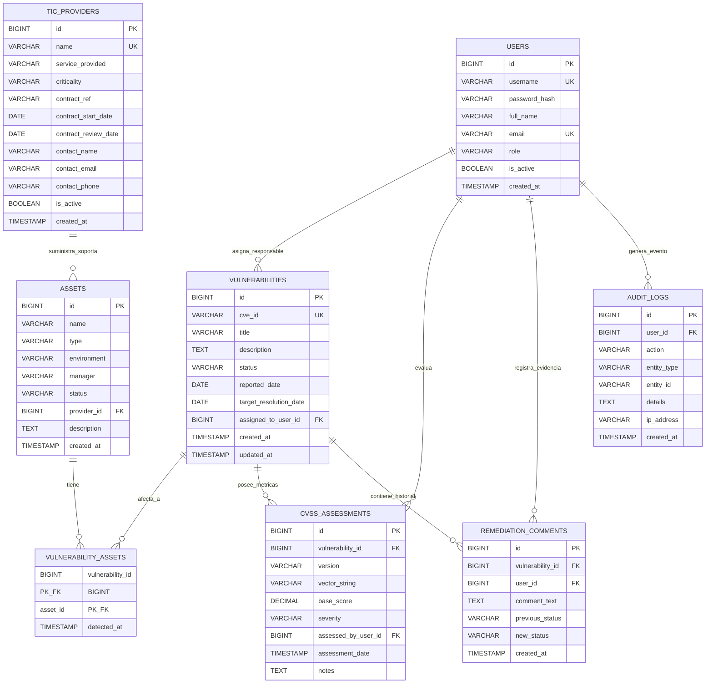

# 📊 Diagrama Entidad-Relación y Modelo de Datos - VulnFollowUp

**Proyecto Intermodular · 2.º DAM · Curso 2026-2027**  
**Módulos implicados:** Acceso a Datos (AD), Sistemas de Gestión Empresarial (SGE), Programación de Servicios y Procesos (PSP)  
**Marco Normativo de Referencia:** Reglamento (UE) 2022/2554 (DORA)  

---

## 1. Diagrama Entidad-Relación (ERD)

A continuación se presenta el diagrama del modelo relacional normalizado en Tercera Forma Normal (3FN), reflejando las entidades principales, claves y cardinalidades del sistema:

---

## 2. Diccionario de Datos

### 👤 2.1. Tabla `users` (Usuarios y Roles)
Representa los usuarios autorizados de la plataforma con autenticación y control de acceso basado en roles (RBAC).

| Campo | Tipo | Nulo | Restricciones | Descripción |
| :--- | :--- | :---: | :--- | :--- |
| `id` | BIGINT | NO | PRIMARY KEY, AUTO_INCREMENT | Identificador único del usuario. |
| `username` | VARCHAR(50) | NO | UNIQUE | Nombre de usuario para autenticación. |
| `password_hash` | VARCHAR(255) | NO | | Hash seguro de la contraseña con salt (BCrypt / Argon2). |
| `full_name` | VARCHAR(100) | NO | | Nombre completo del usuario / analista. |
| `email` | VARCHAR(120) | NO | UNIQUE | Correo electrónico corporativo. |
| `role` | VARCHAR(20) | NO | CHECK (role IN ('ADMIN', 'ANALYST', 'VIEWER')) | Rol del sistema (requisito de 3 perfiles). |
| `is_active` | BOOLEAN | NO | DEFAULT TRUE | Indicador de cuenta activa / desactivada. |
| `created_at` | TIMESTAMP | NO | DEFAULT CURRENT_TIMESTAMP | Fecha de alta en el sistema. |

---

### 🏢 2.2. Tabla `tic_providers` (Proveedores TIC - Módulo SGE / DORA)
Cumple con las exigencias del Reglamento (UE) 2022/2554 (DORA) sobre gobernanza y supervisión de dependencias de terceros prestadores de servicios TIC.

| Campo | Tipo | Nulo | Restricciones | Descripción |
| :--- | :--- | :---: | :--- | :--- |
| `id` | BIGINT | NO | PRIMARY KEY, AUTO_INCREMENT | Identificador único del proveedor TIC. |
| `name` | VARCHAR(100) | NO | UNIQUE | Denominación o razón social del proveedor. |
| `service_provided` | VARCHAR(150) | NO | | Tipo de servicio TIC (Hosting, Pasarela de Pagos, SaaS, etc.). |
| `criticality` | VARCHAR(20) | NO | CHECK (criticality IN ('BAJA', 'MEDIA', 'ALTA', 'CRITICA')) | Nivel de criticidad para la entidad financiera (DORA). |
| `contract_ref` | VARCHAR(50) | SÍ | | Código / referencia del contrato de servicio. |
| `contract_start_date` | DATE | SÍ | | Fecha de inicio del contrato. |
| `contract_review_date` | DATE | NO | | Fecha límite de revisión periódica del contrato y cumplimiento. |
| `contact_name` | VARCHAR(100) | SÍ | | Nombre de la persona de contacto en el proveedor. |
| `contact_email` | VARCHAR(120) | SÍ | | Correo electrónico de contacto o soporte. |
| `contact_phone` | VARCHAR(30) | SÍ | | Teléfono de contacto de emergencias / incidencias. |
| `is_active` | BOOLEAN | NO | DEFAULT TRUE | Estado operativo del proveedor en la entidad. |
| `created_at` | TIMESTAMP | NO | DEFAULT CURRENT_TIMESTAMP | Fecha de registro del proveedor. |

---

### 💻 2.3. Tabla `assets` (Activos Tecnológicos)
Representa los sistemas, servidores, servicios y bases de datos que forman parte de la infraestructura de la entidad financiera.

| Campo | Tipo | Nulo | Restricciones | Descripción |
| :--- | :--- | :---: | :--- | :--- |
| `id` | BIGINT | NO | PRIMARY KEY, AUTO_INCREMENT | Identificador único del activo. |
| `name` | VARCHAR(100) | NO | | Nombre descriptivo del activo (ej. "API de pagos"). |
| `type` | VARCHAR(50) | NO | | Categoría técnica (API, SERVIDOR_APP, BBDD, FIREWALL). |
| `environment` | VARCHAR(30) | NO | CHECK (environment IN ('PRODUCCION', 'PREPRODUCCION', 'DESARROLLO')) | Entorno de despliegue. |
| `manager` | VARCHAR(100) | NO | | Responsable técnico / propietario del activo. |
| `status` | VARCHAR(20) | NO | CHECK (status IN ('ACTIVO', 'INACTIVO', 'MANTENIMIENTO')) | Estado operativo del activo. |
| `provider_id` | BIGINT | SÍ | FOREIGN KEY REFERENCES `tic_providers(id)` | Proveedor TIC que suministra o soporta el activo (NULL si es interno). |
| `description` | TEXT | SÍ | | Descripción de la función y componentes del activo. |
| `created_at` | TIMESTAMP | NO | DEFAULT CURRENT_TIMESTAMP | Fecha de alta del activo. |

---

### 🛡️ 2.4. Tabla `vulnerabilities` (Vulnerabilidades)
Registra las amenazas técnicas detectadas, su ciclo de vida y remediación operativa.

| Campo | Tipo | Nulo | Restricciones | Descripción |
| :--- | :--- | :---: | :--- | :--- |
| `id` | BIGINT | NO | PRIMARY KEY, AUTO_INCREMENT | Identificador numérico interno. |
| `cve_id` | VARCHAR(50) | NO | UNIQUE | Identificador formal (ej. "CVE-2024-3094" o código interno "VFU-0012"). |
| `title` | VARCHAR(200) | NO | | Título breve y conciso de la vulnerabilidad. |
| `description` | TEXT | NO | | Explicación detallada de la vulnerabilidad y posibles impactos. |
| `status` | VARCHAR(30) | NO | CHECK (status IN ('ABIERTA', 'PENDIENTE_REMEDIACION', 'RESUELTA', 'CERRADA')) | Ciclo de remediación normativo. |
| `reported_date` | DATE | NO | | Fecha de descubrimiento o reporte de la vulnerabilidad. |
| `target_resolution_date` | DATE | SÍ | | Fecha límite objetivo para completar la corrección. |
| `assigned_to_user_id` | BIGINT | SÍ | FOREIGN KEY REFERENCES `users(id)` | Analista asignado como responsable de la remediación. |
| `created_at` | TIMESTAMP | NO | DEFAULT CURRENT_TIMESTAMP | Fecha de creación del registro. |
| `updated_at` | TIMESTAMP | NO | DEFAULT CURRENT_TIMESTAMP ON UPDATE CURRENT_TIMESTAMP | Última modificación del registro. |

---

### 🔗 2.5. Tabla `vulnerability_assets` (Relación N:M Activo - Vulnerabilidad)
Garantiza la relación de muchos a muchos obligatoria por el enunciado: una vulnerabilidad puede impactar a múltiples activos, y un activo puede presentar múltiples vulnerabilidades.

| Campo | Tipo | Nulo | Restricciones | Descripción |
| :--- | :--- | :---: | :--- | :--- |
| `vulnerability_id` | BIGINT | NO | PK, FK REFERENCES `vulnerabilities(id)` ON DELETE CASCADE | Vulnerabilidad identificada. |
| `asset_id` | BIGINT | NO | PK, FK REFERENCES `assets(id)` ON DELETE CASCADE | Activo afectado. |
| `detected_at` | TIMESTAMP | NO | DEFAULT CURRENT_TIMESTAMP | Momento exacto de detección en dicho activo. |

---

### 📐 2.6. Tabla `cvss_assessments` (Valoraciones CVSS v3.1 / v4.0)
Almacena el detalle métrico del estándar CVSS Base conforme al apartado 3 del enunciado.

| Campo | Tipo | Nulo | Restricciones | Descripción |
| :--- | :--- | :---: | :--- | :--- |
| `id` | BIGINT | NO | PRIMARY KEY, AUTO_INCREMENT | Identificador de la evaluación. |
| `vulnerability_id` | BIGINT | NO | FOREIGN KEY REFERENCES `vulnerabilities(id)` ON DELETE CASCADE | Vulnerabilidad evaluada. |
| `version` | VARCHAR(10) | NO | CHECK (version IN ('3.1', '4.0')) | Versión del estándar CVSS utilizado. |
| `vector_string` | VARCHAR(150) | NO | | Cadena del vector Base (ej. `CVSS:3.1/AV:N/AC:L/...`). |
| `base_score` | DECIMAL(3,1) | NO | CHECK (base_score >= 0.0 AND base_score <= 10.0) | Puntuación numérica Base calculada (0.0 - 10.0). |
| `severity` | VARCHAR(20) | NO | CHECK (severity IN ('NINGUNA', 'BAJA', 'MEDIA', 'ALTA', 'CRITICA')) | Severidad cualitativa coherente con el score. |
| `assessed_by_user_id` | BIGINT | SÍ | FOREIGN KEY REFERENCES `users(id)` | Usuario/Analista que realizó la valoración. |
| `assessment_date` | TIMESTAMP | NO | DEFAULT CURRENT_TIMESTAMP | Fecha de la valoración. |
| `notes` | TEXT | SÍ | | Justificación técnica de las métricas seleccionadas. |

---

### 💬 2.7. Tabla `remediation_comments` (Evidencias y Trazabilidad de Remediación)
Permite al analista registrar evidencias breves al transicionar de estado (CU4) y presentar justificaciones auditables ante el cliente (CU5).

| Campo | Tipo | Nulo | Restricciones | Descripción |
| :--- | :--- | :---: | :--- | :--- |
| `id` | BIGINT | NO | PRIMARY KEY, AUTO_INCREMENT | Identificador del comentario / evidencia. |
| `vulnerability_id` | BIGINT | NO | FOREIGN KEY REFERENCES `vulnerabilities(id)` ON DELETE CASCADE | Vulnerabilidad sobre la que se actúa. |
| `user_id` | BIGINT | NO | FOREIGN KEY REFERENCES `users(id)` | Autor de la evidencia o cambio. |
| `comment_text` | TEXT | NO | | Evidencia de remediación (parche aplicado, commit, mitigación). |
| `previous_status` | VARCHAR(30) | SÍ | | Estado previo al cambio. |
| `new_status` | VARCHAR(30) | SÍ | | Nuevo estado tras la acción. |
| `created_at` | TIMESTAMP | NO | DEFAULT CURRENT_TIMESTAMP | Fecha de registro de la evidencia. |

---

### 📜 2.8. Tabla `audit_logs` (Registro de Auditoría del Sistema)
Cumple con los requisitos de seguridad y concurrencia (apartados 6, 9 y 10), registrando eventos relevantes sin exponer secretos ni contraseñas.

| Campo | Tipo | Nulo | Restricciones | Descripción |
| :--- | :--- | :---: | :--- | :--- |
| `id` | BIGINT | NO | PRIMARY KEY, AUTO_INCREMENT | Identificador del evento de auditoría. |
| `user_id` | BIGINT | SÍ | FOREIGN KEY REFERENCES `users(id)` ON DELETE SET NULL | Usuario ejecutor (NULL si es proceso automático). |
| `action` | VARCHAR(50) | NO | | Tipo de acción (LOGIN, CREATE, UPDATE, IMPORT_JSON, EXPORT_REPORT). |
| `entity_type` | VARCHAR(50) | NO | | Entidad afectada (VULNERABILITY, ASSET, PROVIDER, USER). |
| `entity_id` | VARCHAR(50) | SÍ | | Identificador de la entidad afectada. |
| `details` | TEXT | SÍ | | Información contextual en JSON o texto plano seguro. |
| `ip_address` | VARCHAR(45) | SÍ | | Dirección IP origen de la petición. |
| `created_at` | TIMESTAMP | NO | DEFAULT CURRENT_TIMESTAMP | Marca temporal exacta del evento. |

---

## 3. Justificación de Decisiones Técnicas y de Diseño

1. **Normalización (3FN):**
   - Se han eliminado redundancias y dependencias transitivas. La asignación de proveedores a activos (`provider_id`) evita duplicar datos del proveedor en cada activo.
   - La relación de vulnerabilidades con activos se abstrae en la tabla puente `vulnerability_assets`, permitiendo que una vulnerabilidad común (ej. log4j) se asocie a decenas de activos sin duplicar su vector ni su descripción.

2. **Gobernanza de Proveedores TIC según DORA (SGE):**
   - Se incorporan los atributos que el marco DORA exige evaluar: criticidad del servicio, fecha de revisión contractual y datos de contacto de emergencia para incidencias operativas.

3. **Separación de Métricas CVSS:**
   - La tabla `cvss_assessments` se desacopla de la definición básica de la vulnerabilidad, permitiendo registrar valoraciones formales con control de versión del estándar (v3.1 o v4.0), vector Base y puntuación.

4. **Integridad Referencial y Restricciones:**
   - Claves foráneas con borrado restringido (`RESTRICT`) en entidades principales para evitar huérfanos.
   - Claves foráneas con borrado en cascada (`CASCADE`) exclusivamente en tablas dependientes (evaluaciones y comentarios de una vulnerabilidad eliminada).
   - Restricciones `CHECK` para validar dominios de datos cerrados (roles, estados, versiones CVSS, rangos de puntuación de 0.0 a 10.0).
